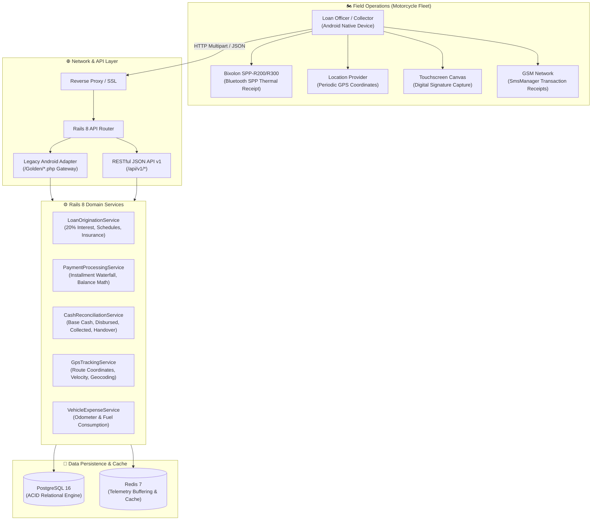
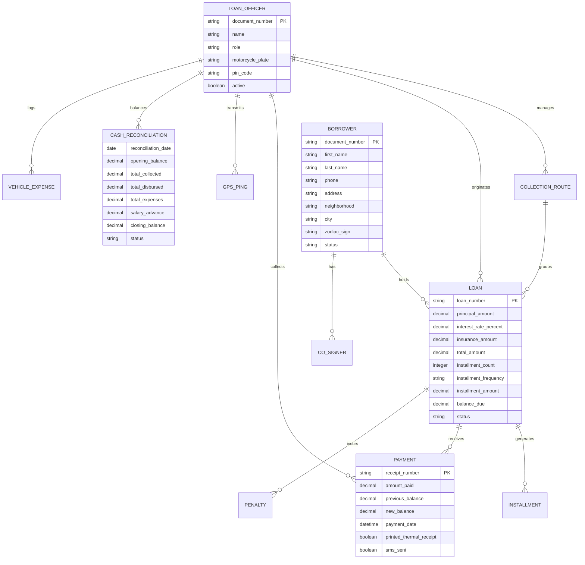

# Android Microfinance Field Banking Platform

[](https://github.com/KevinAndrey96/android-microfinance-field-banking-platform/actions/workflows/ci.yml)
[](https://rubyonrails.org/)
[](https://developer.android.com/)
[](https://www.postgresql.org/)
[](https://www.docker.com/)
[](https://www.bixolon.com/)

A full-stack, enterprise-grade Microfinance and Field Banking platform designed for doorstep lending operations, field debt collection, and financial accounting. Built to coordinate loan officers on motorcycles navigating commercial routes and municipal hubs in the Tolima region of Colombia (Ibagué, El Espinal, Melgar, Chaparral, Honda).

The system pairs a native Android field application (equipped with portable Bluetooth thermal receipt printing, live GPS telemetry, digital touchscreen signatures, and offline SMS fallback) with a high-performance Ruby on Rails 8 API backend orchestrating loan origination, dynamic amortization schedules, audit ledgers, fuel monitoring, and end-of-day cashbox reconciliation.

---

## 🏛️ System Architecture



---

## 📊 Domain Entity Relationship Diagram (ERD)



---

## 🛠️ Key Modules & Field Engineering Highlights

### 1. Bluetooth Thermal Receipt Printing (Bixolon SPP)
* Connects directly via Bluetooth Serial Port Profile (SPP) with mobile belt printers (`BxlService`).
* Dynamically compiles and prints transaction receipts including:
  * Official Crediexpress Golden branding banner.
  * Customer identification and loan pin identifier.
  * Security challenge response (Zodiac sign verification).
  * Transaction timestamp, installment amount paid, and remaining capital balance.
  * Delinquency flags and collector identity tag.
  * Customer service helpline.

### 2. Live GPS Telemetry & Fleet Tracking
* Background location listener transmitting periodic latitude, longitude, and geocoded street addresses.
* Allows operations supervisors to visualize route compliance, route stops, and transit velocities across Tolima highways and rural municipal access roads.

### 3. Digital Touchscreen Signature Capture
* Custom landscape `CanvasView` enabling borrowers to sign loan origination contracts and payment vouchers directly on the collector's device with finger input, uploading vectorized bitmap evidence.

### 4. Amortization Engine & Waterfall Payment Processing
* Supports daily, weekly, biweekly, and monthly microcredit structures.
* Automatically schedules installment calendars, skipping non-banking days (Sundays).
* Cascading payment waterfall that clears the oldest overdue installments first and updates remaining principal balances atomically.

### 5. Motorcycle Fuel & Logistics Ledger
* Field tracking of motorcycle odometer readings (`odometer_reading`) and fuel expenditures, correlating distance traveled against collections achieved per route.

### 6. End-of-Day Cashbox Reconciliation (`Caja`)
* Computes financial balance at the end of each shift:
  $$\text{Closing Balance} = \text{Opening Base Cash} + \text{Collections} - \text{Disbursements} - \text{Expenses} - \text{Salary Advances}$$
* Guarantees zero cash leakage between field collectors and central administration.

---

## 📂 Monorepo Structure

```
android-microfinance-field-banking-platform/
├── apps/
│   └── android/                      # Native Android Field Collector Application (Java)
│       ├── app/
│       │   ├── src/main/java/        # 36 Activities, Bluetooth print drivers, GPS telemetry
│       │   ├── src/main/res/         # XML layouts, drawables, strings, color palettes
│       │   └── libs/                 # Bxlprint.jar, httpmime.jar, urlimageviewhelper.jar
│       ├── BixolonPrinterSampleCode/ # Reference hardware integration workspace
│       ├── build.gradle              # Android build configuration
│       └── settings.gradle
├── backend/
│   └── rails-api/                    # Modern Ruby on Rails 8.1 API Backend
│       ├── app/
│       │   ├── controllers/
│       │   │   ├── api/v1/           # Standard RESTful JSON endpoints (Loans, Payments, Borrowers)
│       │   │   └── legacy/           # Backward-compatible gateway for native Android app (.php)
│       │   ├── models/               # Domain entities (Loan, Borrower, Payment, CashReconciliation)
│       │   └── services/             # LoanOriginationService, PaymentProcessingService
│       ├── config/                   # Routes, database.yml, Puma, CORS configuration
│       ├── db/
│       │   ├── migrate/              # Database schema migrations
│       │   └── seeds.rb              # Realistic Tolima regional seed dataset
│       ├── test/                     # Minitest test suite (models, services, integration)
│       ├── Dockerfile                # Production-ready multi-stage container build
│       └── Gemfile                   # Rails 8, PostgreSQL, SQLite, Puma, Solid Queue
├── docker-compose.yml                # Multi-container orchestration (Rails API, PostgreSQL 16, Redis 7)
├── Makefile                          # Developer automation targets
└── README.md                         # Technical reference documentation
```

---

## 🚀 Quick Start Guide

### Prerequisites
* Docker & Docker Compose (v2)
* Alternatively: Ruby 3.2+ with Bundler installed locally

### Option A: Launch with Docker Compose (Recommended)

```bash
# 1. Clone repository
git clone git@github.com:KevinAndrey96/android-microfinance-field-banking-platform.git
cd android-microfinance-field-banking-platform

# 2. Launch database, redis, and API services
docker compose up -d

# 3. View container status
docker compose ps
```

The Rails 8 API backend is available at `http://localhost:3000`.

### Option B: Local Development Setup

```bash
cd backend/rails-api

# Install dependencies into local vendor bundle
bundle config set --local path 'vendor/bundle'
bundle install

# Prepare database and execute seeds
bundle exec rails db:prepare
bundle exec rails db:seed

# Launch Rails server
bundle exec rails server -p 3000
```

---

## 🧪 Automated Testing

The Ruby on Rails test suite verifies domain models, loan calculations, payment waterfalls, and HTTP gateway compatibility:

```bash
cd backend/rails-api
bundle exec rails test
```

All 13 tests pass with 50 assertions covering:
* Loan origination mathematical accuracy and installment generation.
* Risk policy compliance (blocked debtor rejection).
* Multi-installment payment cascading and balance updates.
* Full legacy gateway endpoint compatibility (`login.php`, `credito.php`, `envio.php`, `envia_ubicacion.php`, `gasolina.php`).

---

## 📜 License

This project is licensed under the MIT License.
